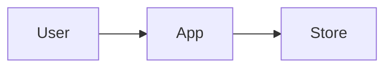

# Mermaid diagrams inside GitHub pull requests

Status: checked 2026-11-25. GitHub's native rendering was seen in a public PR description for three flowcharts and a class diagram. For a private PR, an authenticated API readback confirmed four Mermaid output containers; that is a structural check, not a visual check of the private page.

## Put the diagram where reviewers read

GitHub renders fenced `mermaid` blocks natively in PR descriptions and comments. A separate website, screenshot or repository-file link does not put the diagram into the PR conversation. Use a description section when it is part of the overview, or a comment when it is a follow-up. Keep the audience and approval boundary of that repository.

A minimal Markdown example:

````markdown
## Architecture


````

## Workflow

1. Read the current PR and resolve the intended destination: description, comment or repository document. Draft the exact Markdown. Get any required approval before posting or editing.
2. Keep existing description text unchanged as a prefix when adding a diagrams section. Append a separator, a clear heading, the diagrams and explanations. Do not silently replace the summary, validation notes or limits.
3. Render the Mermaid locally first to catch syntax errors and inspect labels, arrows, boundaries and clipping. Local success does not prove GitHub compatibility; GitHub can use a different Mermaid version.
4. Save the approved Markdown, then read the PR back. Confirm the title is unchanged, the existing text remains, and every intended Mermaid block is present.
5. Open the actual PR and inspect the rendered diagrams. For a public PR, a signed-out browser can verify the reader experience. Wait for the diagram frames to finish loading, scroll through every diagram and capture useful screenshots.
6. For a private PR, use an authorized signed-in browser for the same pixel check. A signed-out 404 does not mean the PR or update is missing. An authenticated API response can confirm the stored Markdown and GitHub's Mermaid output containers, but cannot prove that the client-side diagrams rendered correctly. Report that limit plainly if a signed-in pixel check is unavailable.

## Pitfalls

- Tall diagrams need scrolling. Wide diagrams can shrink labels. Inspect the result at the intended reading width and try GitHub's diagram expand, zoom and pan controls. Split a view only when it helps explain the system.
- A loading placeholder or Mermaid container in HTML is not a finished diagram. Check actual pixels, not only successful storage or HTML markup.
- Preserve the difference between proposed and deployed behavior. A diagram should not imply that an open PR has merged or that its feature is running.
- Do not publish private source, identifiers, configuration or personal context in a public preview. Use a public trial only when its content and audience are approved.
- A temporary preview PR can be closed unmerged after the real PR is updated and checked. Do not delete its branch or change a live site unless that was requested.

This is a documentation workflow note, not an implemented Denyut GitHub integration.

## Reference

- [GitHub: creating diagrams](https://docs.github.com/en/get-started/writing-on-github/working-with-advanced-formatting/creating-diagrams), documents Mermaid support in pull requests and how to check GitHub's Mermaid version.

---

Built with AI assistance (Instinct). Not everything has been reviewed by Irvan.
